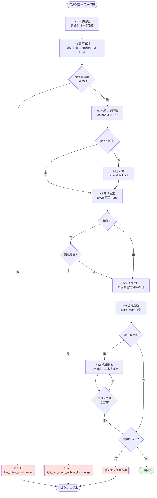
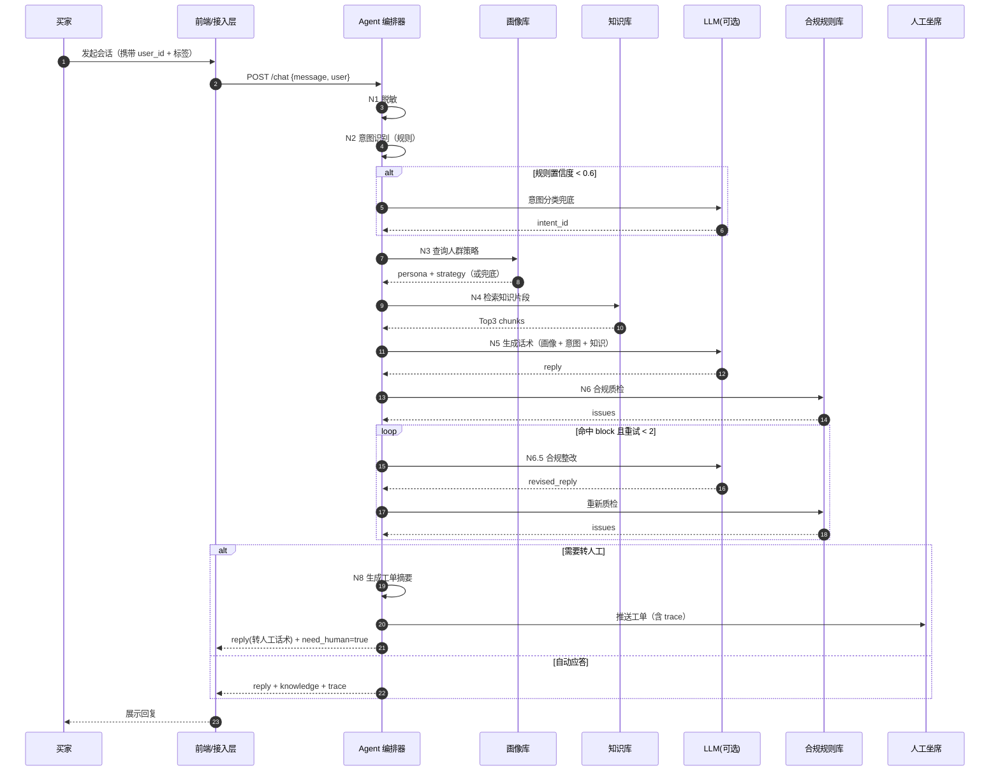

# Agent 节点拆解 · 架构流程图 · 业务时序图

> 对应交付物 D2
> 说明：本文件既是文档，也是 Dify 工作流与代码版 `src/agent.py` 的对照说明，
> 两条路线的节点、变量名、顺序完全一致。

---

## 一、Agent 节点总览

| # | 节点 | 类型 | 输入 | 输出 | 失败兜底 |
|---|---|---|---|---|---|
| N1 | 入参脱敏 | 代码 | message | clean_message | 正则异常则原样透传 |
| N2 | 意图识别 | LLM / 规则 | clean_message | intent_id, intent_confidence | 无命中 → other + 低置信度 → 转人工 |
| N3 | 标签人群匹配 | 代码（规则） | user.tags + intent_id | persona_id, persona_score, strategy | 无命中 → general_fallback |
| N4 | 知识检索 | 知识库 / BM25 | clean_message | knowledge_chunks | 无命中 → 空列表，后续转人工判断 |
| N5 | 话术生成 | LLM / 模板 | persona + intent + knowledge | reply | LLM 失败 → 模板生成 |
| N6 | 合规质检 | 代码（正则） | reply | compliance_issues, blocking | 无 |
| N6.5 | 合规整改 | LLM / 替换 | reply + issues | revised_reply | 本地规则替换 |
| N7 | 转人工决策 | 代码（条件） | 全部上下文 | need_human, handoff_reason | 默认 false |
| N8 | 工单摘要 | 模板 / LLM | 会话上下文 | ticket_summary | 无 |

---

## 二、架构流程图

---

## 三、业务时序图

---

## 四、工具调用逻辑

本 Agent 的工具分为**内部工具**与**外部工具**两类。

### 4.1 内部工具（一期已实现，纯函数）

| 工具 | 签名 | 调用时机 | 说明 |
|---|---|---|---|
| `redact` | `(text) -> text` | 每次请求第一步 | 隐私保护，不可跳过 |
| `intent.classify` | `(message) -> IntentResult` | 每请求一次 | 规则优先 |
| `matcher.match` | `(user, intent_id) -> PersonaMatch` | 每请求一次 | 纯规则，无 IO |
| `retriever.search` | `(query, top_k) -> list[KnowledgeHit]` | 每请求一次 | 内存计算 |
| `compliance.check` | `(text) -> list[ComplianceIssue]` | 生成后 + 每次整改后 | 正则匹配 |
| `compliance.sanitize` | `(text) -> text` | 整改失败最后一道 | 兜底替换 |

### 4.2 外部工具（二期，HTTP 工具节点）

| 工具 | 接口 | 触发意图 | 超时 | 失败兜底 |
|---|---|---|---|---|
| 订单查询 | `GET /oms/orders/{order_no}` | order_query | 3s | 回复"正在查询" + 转人工 |
| 物流轨迹 | `GET /oms/logistics/{order_no}` | logistics | 3s | 同上 |
| 库存查询 | `GET /wms/stock/{sku}` | product_consult | 3s | 不承诺库存，引导人工 |
| 优惠券校验 | `GET /promo/coupons?uid=` | price_promo | 2s | 只报已知券，不臆测 |

**工具调用原则**：
1. 工具结果**优先级高于知识库**（实时数据 > 文档政策）；
2. 工具超时或失败**绝不编造**，统一走"核实后答复 + 转人工"；
3. 工具调用必须在合规质检**之前**，避免把工具返回的原始数据直接透出。

---

## 五、节点变量命名对照表（Dify ↔ 代码版）

| 变量 | Dify 变量名 | 代码版字段 | 类型 |
|---|---|---|---|
| 用户消息 | `user_message` | `ChatRequest.message` | string |
| 用户标签 JSON | `user_tags` | `UserProfile.tags` | object |
| 意图 id | `intent_id` | `IntentResult.intent` | string |
| 意图置信度 | `intent_confidence` | `IntentResult.confidence` | number |
| 人群 id | `persona_id` | `PersonaMatch.persona_id` | string |
| 人群得分 | `persona_score` | `PersonaMatch.score` | number |
| 人群策略 JSON | `persona_strategy` | `PersonaMatch.strategy` | object |
| 知识片段 | `knowledge_text` | `list[KnowledgeHit]` 拼接 | string |
| 回复文案 | `reply` | `ChatResponse.reply` | string |
| 合规问题 | `compliance_issues` | `list[ComplianceIssue]` | array |
| 是否转人工 | `need_human` | `ChatResponse.need_human` | boolean |
| 转人工原因 | `handoff_reason` | `ChatResponse.handoff_reason` | string |
| 工单摘要 | `ticket_summary` | `ChatResponse.ticket_summary` | string |

**为什么要维护这张表**：保证客户从 Dify 切到私有化代码版（或反之）时，
前端与上游系统零改造，这也是双路线交付的核心价值。

---

## 六、6 类画像的策略差异速查（给运营）

| 画像 | 称呼 | 第一句必须是 | 禁区 | 收尾动作 |
|---|---|---|---|---|
| 高价值忠诚VIP | 尊敬的 V4/V5 会员 | 结论 | 泛化称呼、引导比价 | 安排专属顾问 |
| 价格敏感新客 | 亲 | 到手价数字 | 绝对化用语、超权限折扣 | 给下单入口 + 券有效期 |
| 焦虑催单型 | 您 | 共情 + 具体时间 | 模糊词（大概/应该） | 主动跟进承诺 |
| 愤怒维权型 | 您 | 道歉（不解释） | 反问用户、推责表述 | 工单号 + 专属处理人 |
| 理性研究型 | 您 | 参数依据 | 夸张形容、回避缺点 | 规格页 + 售后条款 |
| 沉默流失预警 | 您 | 一个钩子 | 连续追问、制造焦虑 | 领券即结束 |

**兜底人群**：中性、简洁、礼貌，先答明确问题再补一条相关信息。